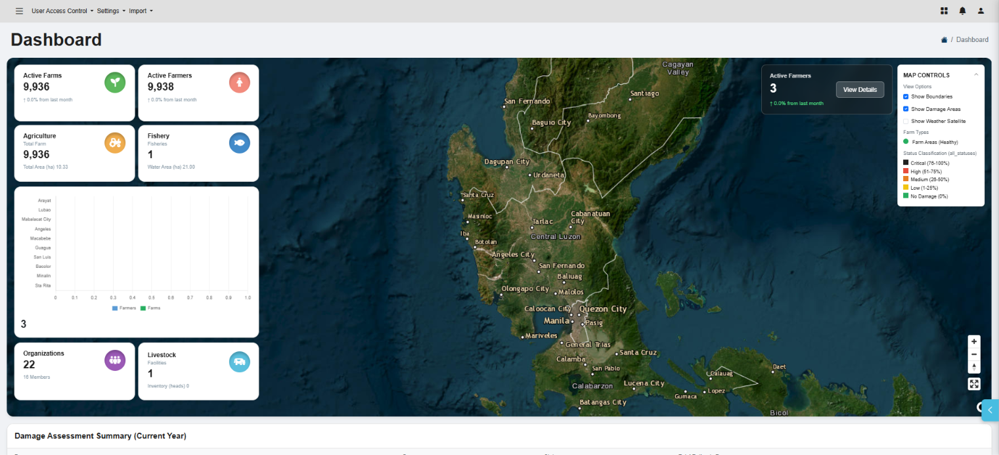
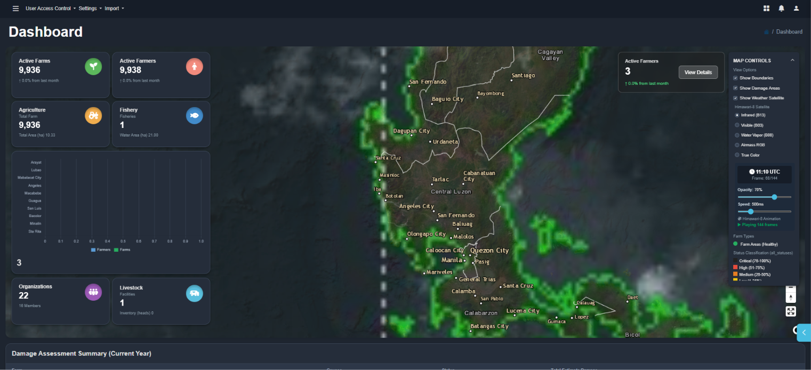
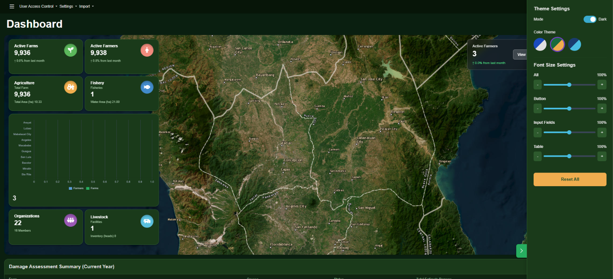

# OPA Dashboard

A geospatial agricultural dashboard for the **Office of Provincial Agriculture (OPA)** of Pampanga, built as a proof-of-concept frontend with PHP, Bootstrap 5 and MapLibre GL.

**Live demo:** [opa-dashboard-green.vercel.app](https://opa-dashboard-green.vercel.app/)



## Features

- 🗺️ Full-width GIS map hero with overlaid stats cards, built with MapLibre GL JS
- 🛰️ Himawari-8 weather satellite animation overlay: Infrared (B13), Visible (B03), Water Vapor (B08), Airmass RGB and True Color, with opacity and speed controls
- 🧭 Map controls to toggle boundaries and damage areas, with a damage status legend (Critical, High, Medium, Low, No Damage)
- 📊 Summary cards for Farms, Farmers, Agriculture, Fishery, Livestock and Organizations
- 📈 Chart.js visualizations: farmers and farms per municipality, plus a Farm Types donut chart
- 📋 Damage Assessment Summary table, Recent Registrations and Recent Interventions
- 🌙 Dark / light mode with three color themes: Default (blue/grey), Agriculture (green/gold) and Ocean (navy/cyan)
- ⚙️ Theme settings panel with font size controls for all text, buttons, input fields and tables

## Screenshots

| Himawari-8 satellite overlay (dark mode)     | Theme settings panel (Agriculture theme) |
| -------------------------------------------- | ---------------------------------------- |
|  |     |

## Built with

- PHP (page assembled from reusable includes)
- [Bootstrap 5](https://getbootstrap.com/) and Bootstrap Icons
- [MapLibre GL JS](https://maplibre.org/) 4.7.1
- [Turf.js](https://turfjs.org/) 7.1.0
- [Chart.js](https://www.chartjs.org/) 4.4.7
- Font Awesome
- Hosted on Vercel as a static build

## Getting started

```bash
git clone https://github.com/InterfaceAlchemist/itbs-proj-opa.git
cd itbs-proj-opa
```

**Run with PHP**

Place the project in your WAMP/XAMPP `www` or `htdocs` folder and open `http://localhost/itbs-proj-opa`. Alternatively, use PHP's built-in server:

```bash
php -S localhost:8000
```

**Build as static HTML**

`index.php` only stitches HTML pieces together with `include`, so it can be exported to plain HTML and hosted without a PHP server:

```bash
node build-static.mjs
```

This writes `dist/index.html` (the Vercel config runs this same command). The build stops with an error if any real PHP code is left in the output.

## About the data

This is a proof of concept. The statistics, charts, damage table, registrations and interventions all run on sample data written into the page, so no backend, database or API key is needed.

External services used at runtime:

- Esri World Imagery and World Boundaries & Places tiles for the satellite basemap and labels
- JMA (Japan Meteorological Agency) for the Himawari-8 satellite frames

## Project structure

```
index.php             main page, assembles the includes below
build-static.mjs      exports the PHP page to dist/index.html
vercel.json           Vercel build settings
parts_includes/
  head.php            styles, color themes and CDN libraries
  navbar.php          top navigation bar
  header.php          page title and breadcrumb
  stats.php           summary stat cards
  map.php             map hero and map controls
  charts.php          chart containers
  table.php           damage assessment table
  theme_panel.php     slide-out theme settings panel
  scripts.php         map, Himawari service, charts and UI logic
  footer.php          closing markup
docs/                 README screenshots
```

## Notes

Built as a frontend project for demonstration. Basemap imagery is provided by Esri and its data providers, and weather imagery by JMA / Himawari-8.
